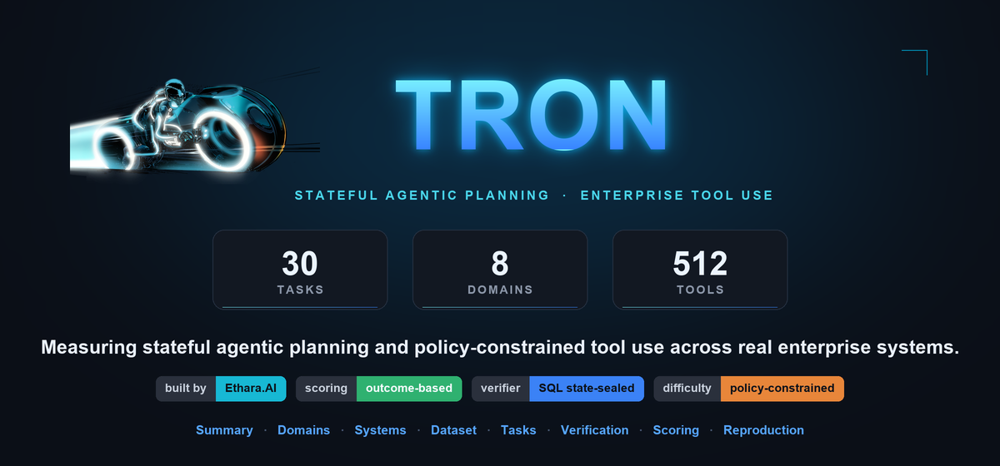
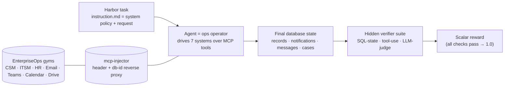
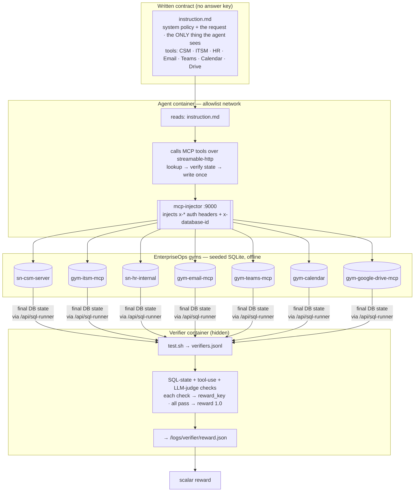
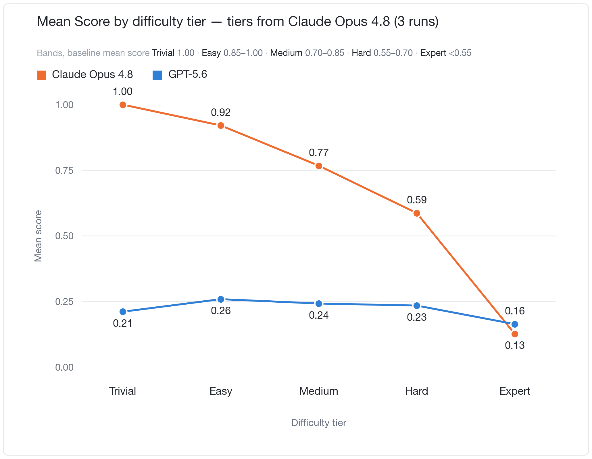

<div align="center">



# Tron

**A verifiable benchmark for enterprise-operations agents — a model resolves real support, HR, and IT operations work across seven simulated enterprise systems (CSM · ITSM · HR · Email · Teams · Calendar · Drive), graded by hidden SQL-state verifiers over the final database, never on the words it wrote.**

[Quickstart](#quickstart) · [The grading contract](#the-grading-contract) · [Datasets](#datasets) · [Reproducibility](#reproducibility--offline-determinism) · [Limitations](#limitations)

[](https://github.com/Ethara-Ai/harbor)     



</div>

**Tron** is a verifiable, **offline** benchmark of **agentic enterprise operations** packaged in [Harbor](https://github.com/Ethara-Ai/harbor) format. A model is handed only a written **system policy plus a work request** — triage a support case, open an HR ticket, route an incident, send an email, post a Teams note, book a meeting, file a document — and must complete it **end to end** by driving real tools across **seven simulated enterprise systems**. A hidden verifier, never shown to the model, scores the run against the **final state of each system's database** — no external SaaS, no network egress, fully deterministic. Reward is **earned through the records the agent actually changed**, not pattern-matched against a reference transcript.

Each system is a self-contained **"gym"** — a dockerized MCP server backed by a seeded SQLite database (a ServiceNow-style CSM and ITSM, an internal HR desk, an email server, Microsoft Teams, a calendar, and Google Drive). The agent reaches them all through a single **`mcp-injector`** reverse proxy that stamps per-gym auth headers and the per-run database id onto every tool call. Grading reads the databases back out with SQL and asks: *is the world in exactly the state a correct operator would have left it in?*

> **Why this matters.** Enterprise agents are judged in production by **what they change in systems of record**, not by how fluent their reply reads. Most "tool-use" benchmarks grade a single call or a string the model can see and overfit. Tron grades **cross-system behavioral state** — the case really routed to the right queue, the resolution article really linked, the email really sent with the verbatim subject, no duplicate and no decoy — with the answer key living only in the verifier. That makes the reward **deterministic, reproducible, and resistant to reward hacking.**

## Architecture



The task runs offline with an **allowlist network** — the agent can reach only the gyms and the injector, nothing on the public internet. A `docker-compose` stack brings up the seven gym servers, a **`seed-init`** step that loads each gym's SQLite database from `environment/seeds/*.sql` and publishes its `database_id` on a shared volume, and the `mcp-injector` sidecar. At grading time a **hidden** verifier the agent never sees queries each gym's database directly and replays the `verifiers.jsonl` check suite.

## Design principles

| Principle | How Tron enforces it |
| :--- | :--- |
| **Verifiable, not similarity-based** | Reward comes from the **database state** the agent produced — the case's `assignment_group_id`, the `case_knowledge` link, the sent email's headers, the Teams `channel_messages` body — never diffing against a reference transcript. |
| **Behavioral state is primary** | A turn that *says* the right thing but leaves the wrong record fails the checks. Correctness is judged by **effect on the systems of record**, not narration. |
| **Exact wording matters** | Customer-facing policy text is checked **verbatim** (e.g. the refund answer must appear character-for-character in the email and the Teams note); paraphrase fails. |
| **Decoys by construction** | Every domain seeds **plausible wrong answers** — superseded knowledge articles, wrong-product policies, look-alike queues — and dedicated `*_absence` checks fail the run if the agent touches them. |
| **Idempotent & single-shot** | Exactly one attempt, database reset between runs; `*_idempotent` checks fail on duplicate cases, notifications, or emails. Extra or partial writes are penalized. |
| **Never-infer** | Identifiers (users, groups, services, queues) must come from **live lookups**, not guesses; policies forbid fabricating ids or inventing text the requester didn't provide. |
| **Offline & deterministic** | Every gym is a seeded SQLite world in-container; the whole stack runs on an allowlist network with no external SaaS and no network egress. |

## The grading contract

Each task ships a hidden **`tests/`** tree. The entrypoint `test.sh` reads every gym's `database_id` from the shared volume, loads `verifiers.jsonl`, runs each check, writes its pass/fail under its own `reward_key`, and sets the scalar **`reward` to `1.0` only if *every* check passes** (otherwise `0.0`). The corpus carries **619 checks across 30 tasks** — from **4 to 55 per task** — of three types:

| Verifier type | What it does | In this corpus |
| :--- | :--- | ---: |
| `database_state` | Runs a SQL query against a gym's `/api/sql-runner` and compares the value (`equals` · `greater_than` · `less_than` · `contains`) to an expected constant. | **617** |
| `tool_execution` | Asserts the agent's trajectory made at least `minimum_tool_calls` to one of `selected_tools` (e.g. it actually *retrieved* the knowledge base). | **2** |
| `response_check` | LLM-as-judge: pulls ground truth via SQL, extracts the agent's final answer from the ATIF trajectory, and scores it against a rubric prompt (`anthropic/claude-haiku-4-5`), passing on `score ≥ minimum`. | 0 (supported) |

Checks come in complementary shapes that together make the reward non-gameable:

- **Presence** — the correct record exists (`verify_resolution_links_authoritative_kb`, `verify_requester_email_verbatim_subject`).
- **Absence / decoy** — the *wrong* record does **not** exist (`verify_case_not_routed_decoy_queue`, `verify_resolution_not_stale_absence`, `verify_notify_not_wrong_kb_absence`).
- **Idempotency** — exactly one of a thing exists (`verify_notify_single_idempotent`, `verify_requester_email_single_idempotent`).
- **Verbatim** — exact policy text is present (`verify_triage_note_answer_verbatim`).

Because the answer key lives only in `verifiers.jsonl` inside the hidden `tests/` tree, and grading reads the databases the agent mutated, **no narration or self-report can buy reward**.

## Task format: Harbor

Tron uses **[Harbor](https://github.com/Ethara-Ai/harbor)** as the task-artifact format: a `task.toml`, an `instruction.md`, a Dockerized `environment/`, and a hidden verifier under `tests/`. Harbor defines the task/reward artifact; any compatible harness or RL trainer consumes it.

**Anatomy of a task** (a delivered bundle under [`dataset/`](dataset/)):

```
dataset/<task-uuid>/
├── task.toml                       # schema 1.0 · task + metadata + environment + agent + verifier
├── instruction.md                  # the system policy + request (the ONLY thing the agent sees)
├── environment/
│   ├── Dockerfile                  #   the agent's main container (python:3.12-slim)
│   ├── docker-compose.yaml         #   gyms + seed-init + mcp-injector + main, wired on one network
│   ├── mcp-injector/               #   FastAPI reverse proxy: injects per-gym headers + x-database-id
│   │   ├── Dockerfile
│   │   ├── injector.py
│   │   └── requirements.txt
│   └── seeds/                      #   per-gym SQL that seeds each gym's SQLite database
│       ├── seed_csm.sql
│       ├── seed_email.sql
│       └── seed_teams.sql          #   (only the gyms this task uses)
└── tests/                          # HIDDEN from the agent
    ├── test.sh                     #   entrypoint: run every verifier → reward.json
    ├── verifiers.jsonl             #   the checks (database_state · tool_execution · response_check)
    └── lib/                        #   db_verifier · response_verifier · tool_verifier · atif_translator
```

The `task.toml` declares the MCP servers the agent is wired to, the exact `selected_tools` it may call, the acting user's identity per gym (`metadata.gym_contexts`), and the resource/timeout envelope (agent `timeout_sec = 1800`, verifier `timeout_sec = 300`, `network_mode = "allowlist"`).

## Datasets

Generated environments live under [`dataset/`](dataset/). **30 tasks** in total, each a self-contained Harbor task over the offline EnterpriseOps gyms, keyed by full UUID. Every task is **difficulty `medium`**; the hardness comes from **cross-system coordination and decoy density**, not from arithmetic.

**By primary category** — 24 tasks are **hybrid** (they span two or more systems); 6 are single-system:

| Category | Tasks |
| :--- | ---: |
| **hybrid** (multi-system) | 24 |
| csm · itsm · hr · email · calendar · drive (single-system) | 6 |

**By system touched** — a single task usually drives several gyms, so these counts overlap:

| System (gym) | MCP server | Port | Tasks that use it |
| :--- | :--- | ---: | ---: |
| Email | `gym-email-mcp` | 8004 | 21 |
| Google Drive | `gym-google-drive-mcp` | 8009 | 16 |
| HR (internal) | `sn-hr-internal` | 8008 | 15 |
| ITSM | `gym-itsm-mcp` | 8006 | 14 |
| Microsoft Teams | `gym-teams-mcp` | 8002 | 12 |
| CSM (customer service) | `sn-csm-server` | 8001 | 11 |
| Calendar | `gym-calendar` | 8003 | 11 |

A representative task: **triage support case CS-KT-4501** — find the *current authoritative* refund article for the exact product (ignoring a superseded one and an enterprise-plan look-alike), link it as the case resolution, route to the correct support queue by exact name, notify the requester, send an email with a **verbatim subject line**, and post a Teams triage note quoting the **exact** refund wording. Sixteen checks grade the case-routing, the resolution link, the notification, the email headers, and the Teams note — including absence checks that fail the run if any decoy article or decoy queue is touched.

## Baseline results

Two frontier agents — **Claude Opus 4.8** and **GPT-5.6** — were run across all 30 tasks, **3 runs each (180 graded runs)**. Trajectories ship under each task's [`trajectories/`](07b2292d-4b61-59c5-b329-f73c09c00317/trajectories/) directory, alongside the per-run verifier results and rubric grades.

### Mean score by difficulty tier

The headline `reward` is all-or-nothing, which collapses a near-miss and a total failure to the same `0.0`. To keep partial progress visible we combine both graded instruments into a single **mean score** per run:

```
mean score = G × ( 0.7 · verifier goal checks  +  0.3 · rubric positive credit )
```

`G` is a hard gate, **zero** if any guard check was violated (an unwanted state change) or any negative rubric criterion triggered (a policy violation) — a violation cannot be averaged away by good process. Verifier checks that pass in **all 180 runs** carry no information and are excluded, so the score is not diluted by assertions no model has ever failed; that removes **349 of 615** checks.

Binning each task by **Claude Opus 4.8's own mean score** — the baseline — into five uniform 0.15-wide bands (Trivial `1.00`, Easy `0.85–1.00`, Medium `0.70–0.85`, Hard `0.55–0.70`, Expert `<0.55`) gives a clean staircase for the baseline, and shows that GPT-5.6 does not track the same difficulty ordering.

The score is reported on a **0–1 scale, not as a percentage**: it is a weighted, gated index rather than a share of a countable whole, so "73% of *what*?" has no answer. This also matches the scale the harness stores it on (`verifier/reward.txt`, `result.json`).



| Tier | Band | Tasks | Claude Opus 4.8 | GPT-5.6 |
| :--- | :--- | ---: | ---: | ---: |
| Trivial | `1.00` | 4 | 1.000 | 0.211 |
| Easy | `0.85–1.00` | 13 | 0.921 | 0.259 |
| Medium | `0.70–0.85` | 4 | 0.767 | 0.243 |
| Hard | `0.55–0.70` | 4 | 0.587 | 0.235 |
| Expert | `<0.55` | 5 | 0.127 | 0.164 |
| **Corpus** | | **30** | **0.734** | **0.231** |

Claude Opus 4.8 decays `1.00 → 0.92 → 0.77 → 0.59 → 0.13`; GPT-5.6 stays flat at `0.21 → 0.26 → 0.24 → 0.23 → 0.16`. **Difficulty for one model is close to uncorrelated with difficulty for the other** — GPT-5.6 scores no better on the tasks Opus solves perfectly than on the ones Opus struggles with. The gap is driven by the gate as much as by the goal checks: it zeroes **32 of 90** GPT-5.6 runs versus **14 of 90** for Opus, i.e. GPT-5.6 trips a guard check or a policy violation on more than a third of its runs. The same runs score **`pass@1` 0.500 (Opus) vs 0.133 (GPT-5.6)**.

> **Reading the Expert tier.** The two lines cross (Opus 0.127 vs GPT-5.6 0.164). This is not GPT-5.6 outperforming on the hardest tasks — the Expert band is defined by Opus failing there, and GPT-5.6 often fails *early enough* that it never reaches the state changes that would trip a guard check. A model that does nothing violates nothing.

## Quickstart

Each task is a standalone Harbor bundle. To run one with a Harbor-compatible harness:

```bash
# 1. Pick a task
cd dataset/08538a80-6390-5c29-b70d-a930436f7205

# 2. Bring up the gyms + seed-init + mcp-injector + agent container
docker compose -f environment/docker-compose.yaml up -d
#    → seed-init loads each gym's SQLite DB from environment/seeds/*.sql
#    → mcp-injector exposes every gym at http://mcp-injector:9000/mcp/<gym>

# 3. Point your agent at the MCP servers declared in task.toml and give it instruction.md
#    (transport = streamable-http; tools limited to selected_tools)

# 4. Grade: run the hidden verifier suite against the final DB state
bash tests/test.sh          # writes /logs/verifier/reward.json
```

`reward.json` carries the scalar `reward` (1.0 only if every check passed) plus one field per check `reward_key` for a granular breakdown of what the agent got right and wrong.

## Reproducibility & offline determinism

Tron treats determinism as a first-class verifier property:

- **Seeded worlds.** Every gym's database is built from checked-in `environment/seeds/*.sql` at container start, so each run begins from an identical, known state — and the database is **reset between runs**.
- **Offline by allowlist.** `network_mode = "allowlist"` limits the agent to the gyms and the injector; there is no public-internet access and no external SaaS in the loop.
- **Deterministic identity injection.** The `mcp-injector` stamps the same per-gym auth headers (`metadata.gym_contexts`) and per-run `x-database-id` onto every tool call, so the agent always acts as the intended user against the intended database.
- **Hidden ground truth.** The answer key is the SQL in `tests/verifiers.jsonl`, mounted only into the verifier — never on the agent filesystem.
- **Self-contained grader.** `tests/lib/*` is stdlib + `httpx` only and travels with the task, so grading cannot drift from the harness that authored it.

## Repository layout

```
tron-samples/
├── README.md            # this dataset card
├── .gitattributes       # Hugging Face LFS tracking
├── images/
│   ├── banner.png              # dataset banner
│   └── mean-score-by-tier.png  # baseline results figure
└── dataset/             # 30 Harbor tasks, one UUID-named dir per task
    ├── README.md        #   dataset-level card (systems, checks, grading contract)
    └── <uuid>/          #   task.toml · instruction.md · environment/ · tests/
```

## Limitations

Tron is a focused corpus, and we state its edges plainly:

- **Single difficulty band.** Every task is authored at `medium`; the corpus varies breadth (how many systems, how many decoys) rather than sweeping an explicit difficulty ladder.
- **All-or-nothing task reward.** The scalar `reward` is `1.0` only when *every* check passes; partial credit is visible only in the per-`reward_key` breakdown, not the headline scalar.
- **Gym images are external.** The gyms run from published `shivakrishnareddyma225/enterpriseops-gym-mcp-*:latest` images; reproducing a run requires pulling them (they are offline once pulled).
- **Judge-graded checks need a model.** `response_check` verifiers (supported, unused in this corpus) call an LLM judge and so are only as deterministic as the judge model pinned in the environment.
- **Curated sample.** This repository is the **samples** surface of the Tron project — a self-contained slice of the full corpus and its harness.

## Citation & credits

- **Harbor** — verifiable agentic task format · <https://github.com/Ethara-Ai/harbor>
- **EnterpriseOps-Gym** — the seeded MCP enterprise-system servers (`enterpriseops-gym-mcp-*`) the tasks run against
- **MCP** — Model Context Protocol, the tool transport (streamable-http) between agent and gyms

```bibtex
@misc{tron2026,
  title  = {Tron: A Verifiable Benchmark for Enterprise-Operations Agents},
  author = {Ethara.AI},
  year   = {2026},
  note   = {30 Harbor tasks over seven seeded EnterpriseOps-Gym MCP systems},
}
```

## License

Released under **CC BY-NC-ND 4.0** (Creative Commons Attribution-NonCommercial-NoDerivatives 4.0 International): share with attribution for non-commercial use, no derivatives. Task environments and gym images retain their own respective licenses.

---

**Tron** · An Ethara.AI project · Task format: [Harbor](https://github.com/Ethara-Ai/harbor) · Tools: MCP over streamable-http · Backend: offline EnterpriseOps gyms.
